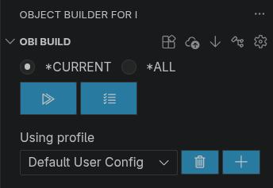
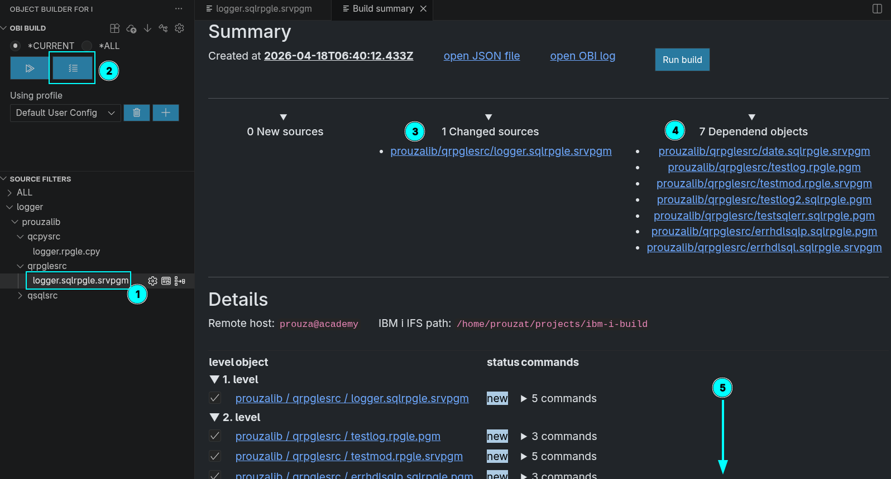
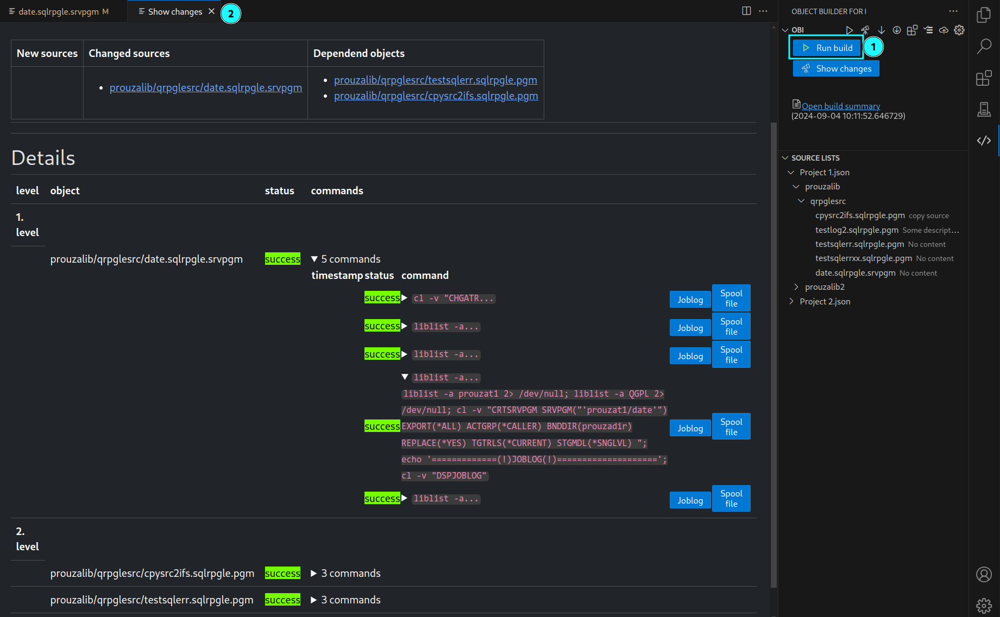
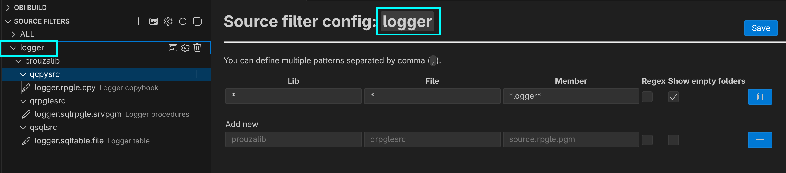
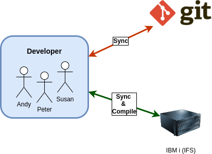

# OBI: Object Builder for i

<p align="center">
  <br>
  <a href="https://www.buymeacoffee.com/prouza"></a>
</p>

**OBI** is a VS Code extension that builds IBM i objects from sources you keep **locally** (and in git).
It detects which sources changed, resolves everything that depends on them, generates the build commands in the correct order and runs them on your IBM i via SSH.
Joblogs, spool files and compile errors come back into VS Code.

Watch the intro (1:38):

https://github.com/user-attachments/assets/7fadaf1e-b4e8-47a6-b405-3fa968cbf247

- [Features](#features)
- [How it works](#how-it-works)
- [Requirements](#requirements)
- [Quick start](#quick-start)
- [Documentation](#documentation)
- [Related projects](#related-projects)


# Features

* **Build profiles**  
  Build only the current source (`*CURRENT`) or all changes (`*ALL`).
  Switch between user profiles (e.g. different target libraries or users) with one click.

  

* **Change detection**  
  OBI stores a hash of every successfully built source and only builds what changed since then.

* **Dependency-aware build order**  
  All objects depending on a changed source are rebuilt as well, in the correct order (e.g. tables before programs).
  See [Dependencies](asserts/docs/dependencies.md).

  

* **Build summary**  
  See every object, its commands and status. Exclude sources or single commands, add sources, edit a command before running it,
  and open the **joblog**, **spool file** and **error output** of each command.

  

* **Compile errors in the Problems view**  
  Compiler messages (`*EVENTF`) are shown directly in your source.

* **Build history**  
  Every build is kept. Browse by date or by source and filter for specific sources.

* **Source filters**  
  Individual source trees with descriptions, a sortable/filterable table view and a quick search over names and descriptions.

  

* **Per-source build settings**  
  Override settings (e.g. `ACTGRP`, `TARGET_LIB`) or the whole list of build steps for single sources.

* **Fully configurable build commands**  
  Commands per source type, with variables such as `$(TARGET_LIB)`, `$(OBJ_NAME)` or your own.

* **Git information** (branch and commit) is stored with each build.

* UI available in **English** and **German**.


# How it works

You work with your sources **locally** on your PC and share them with your team via **git**.
The IFS is only used to compile.



1. **Show changes**: OBI compares the local sources with the last successful build and creates a build list (including all dependent objects).
2. **Run build**: the configuration and the sources to build are transferred to the IFS via SSH.
3. The [OBI backend](https://github.com/andreas-prouza/obi) on your IBM i runs the build commands.
4. Results (status, joblog, spool files, compile errors) are downloaded and shown in the build summary.


# Requirements

**On IBM i**
* SSH daemon running (`STRTCPSVR *SSHD`)
* Open source package manager (YUM) with `bash`
* Python 3.12 or higher
* The [OBI backend](https://github.com/andreas-prouza/obi) cloned into the IFS and set up (`setup.sh`)
* A home directory for your user profile (see the [SSH setup](asserts/docs/ssh.md))

**On your PC**
* VS Code 1.90 or higher
* SSH access to your IBM i (SSH key recommended, password also possible)
* Optional: git

A local Python installation is **not** required. The build list is generated by the extension itself.


# Quick start

1. Set up SSH and your user profile on IBM i: [SSH setup](asserts/docs/ssh.md)
2. Install the OBI backend on IBM i:
   ```sh
   git clone https://github.com/andreas-prouza/obi /path/to/obi
   cd /path/to/obi
   ./setup.sh
   ```
3. Open an (empty) project folder in VS Code, switch to the **Object Builder for i** view and click **Initialize**.
4. Fill in the mandatory settings (remote host, SSH user, remote OBI path, ...) and save.
5. Put your sources into `src/<library>/<source file>/<member>.<attribute>.<type>` (e.g. `src/mylib/qrpglesrc/hello.rpgle.pgm`).
6. Click **Show changes**, then **Run build**.

The detailed walkthrough is in [Getting started](asserts/docs/getting-started.md).


# Documentation

| Guide | Content |
|---|---|
| [Getting started](asserts/docs/getting-started.md) | IBM i setup, project initialization, minimum configuration, migrating existing sources |
| [SSH setup](asserts/docs/ssh.md) | SSH daemon, bash, home directory, key authentication |
| [Building](asserts/docs/building.md) | Show changes, build summary, run build, compile errors, build history |
| [Sources](asserts/docs/sources.md) | Folder layout, source filters, quick search, descriptions |
| [Dependencies](asserts/docs/dependencies.md) | Defining dependencies between sources and how they affect the build order |
| [Configuration](asserts/docs/configuration.md) | All config files, settings, profiles, build commands, variables, per-source settings |

Want to work on OBI itself? See [CONTRIBUTING.md](CONTRIBUTING.md).


# Related projects

* [OBI](https://github.com/andreas-prouza/obi): the build backend running on IBM i
* [ibm-i-build-obi](https://github.com/andreas-prouza/ibm-i-build-obi): using OBI without VS Code (RDi, other IDEs) and further examples
* [cpysrc2ifs](https://github.com/andreas-prouza/ibm-i-build-obi/blob/main/src/prouzalib/qrpglesrc/cpysrc2ifs.sqlrpgle.pgm): RPG program to copy source members into the IFS

**Happy building!**
