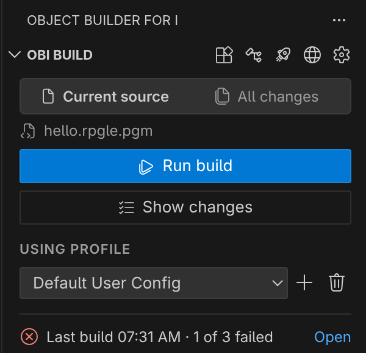
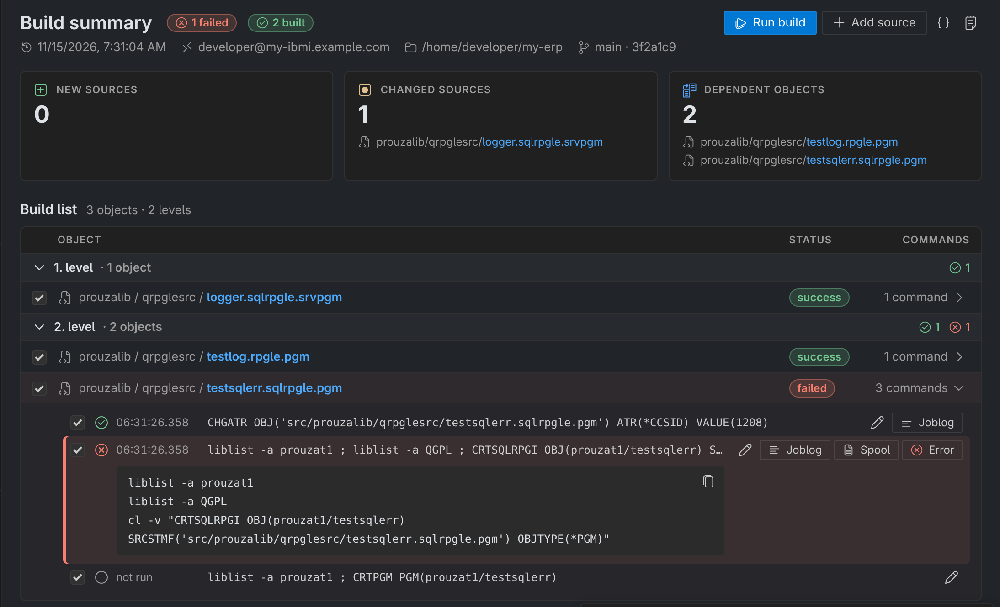

[← Back to README](../../README.md)

# Building

- [The OBI Build view](#the-obi-build-view)
- [Preview build](#preview-build)
- [Build summary](#build-summary)
- [Run build](#run-build)
- [Build packages](#build-packages)
- [Compile errors](#compile-errors)
- [Build history](#build-history)
- [Other actions](#other-actions)
- [Build output files](#build-output-files)


## The OBI Build view



| Element | Meaning |
|---|---|
| **Current source** / **All changes** | Build only the source in the active editor (`*CURRENT`, its name is shown below), or all changes in the project (`*ALL`) |
| **Run build** | Preview build, then build |
| **Preview build** | Create the build list and open the build summary |
| *Using profile* | Active user profile; ➕ copies it into a new profile, 🗑 deletes it (see [Profiles](configuration.md#profiles)) |
| *Last build* | Time and result of the current build list; **Open** opens its build summary |

While an operation runs (also one started elsewhere), the buttons are replaced by its name, the elapsed time and **Cancel**.

Toolbar buttons (left to right):

| Button | Action |
|---|---|
| Reset compiled object list | Mark all current sources as built (see [below](#reset-compiled-object-list)) |
| Dependency list | Open `.obi/etc/dependency.json` |
| i-Releaser config, Open i-Releaser | Open the [i-Releaser](#i-releaser-deployment) deployment config, or i-Releaser in the browser. Without a URL in `.obi/etc/deployment.toml`, **Open i-Releaser** offers the deployment config |
| Configuration | Open the configuration |

When a source (`.pgm`, `.srvpgm`, `.module`, `.file`) is open in the editor, the editor title bar also offers **Show single change**, **Run single build** and **Clear diagnostics** for that source.

### Status bar

The status bar shows the active profile and the result of the last build (a check mark with its time, or the number of failed sources), or the running operation, with the elapsed time in the tooltip. Click it for a menu: run build (all changes or the current source), preview build, open build summary, switch profile, cancel the running operation, show build output or log. Turn it off with the setting `obi.statusBar.enabled`.


## Preview build

**Preview build** creates the build list and opens the build summary. Nothing is executed on IBM i.

1. **Change detection**: OBI computes a hash of every source and compares it with the hashes of the last successful build (`.obi/etc/object-builds.json`).
   * Source not in the list → **new**
   * Different hash → **changed**
2. **Dependencies**: all objects depending on a new or changed source are added, recursively (see [Dependencies](dependencies.md)).
3. **Levels**: changed sources are placed on level 1, their dependent objects on higher levels. Within a level, files (`*.file`) come first.
   An object that appears several times is only built once, on its highest level.
4. **Commands**: for each source the build steps are resolved and all [variables](configuration.md#variables) are substituted.

The result is written to `.obi/build-output/compile-list.json`.

With **Current source** (`*CURRENT`, or **Show single change** in the editor), only the active source and its dependent objects are considered. The active source is always included, even if it has not changed.

> If a *local OBI path* is configured and contains a Python virtual environment, the local OBI backend generates the build list instead of the extension. This is optional.


## Build summary



**Header**
* The result as labels: how many sources failed, were built, are still to build
* Creation time, user and host, the user profile (the active one; for a build from the history the one it was built with), IFS path, and the git branch and commit of the build
* **Run build**: shown as long as not all commands succeeded
* **Add source**: add further sources (multi-select, searchable by name and description). Their dependent objects are added too.
  An added source that is already in the list gets new build commands. Dependent objects that were already built successfully are reset so they are built again (their commands and output are kept). With `ALWAYS_TRANSFER_RELATED_COPYBOOKS`, the copybooks they use are added on level 0. The levels of the whole list are calculated again, so a source can move to a higher level. This is the same with and without a local OBI.
* **Add to build package**: adds the sources of this build list to a [build package](#build-packages) (see there).
* **Start i-Releaser workflow**: shown when all commands succeeded and an [i-Releaser](#i-releaser-deployment) is configured. After the start, the [deployment card](#i-releaser-deployment) shows it.
* `{}` opens the compile list (JSON), the log icon the OBI log (`.obi/log/main.log`)

**New sources / Changed sources / Dependent objects**: the number of each, with the first sources as links; **+ … more** shows the others. A click on **Sources** collapses the section; its head still shows the three numbers, and the page keeps it collapsed until you open it again.

**Build list**: all levels, each with its number of objects and the result (✓ built, ✗ failed, ○ open); click a level to fold it. For each source:
* **Checkbox**: exclude the source from the build, whatever its status. The choice is saved in the compile list at once (`ignore`), so it stays after the page is updated or reopened. An unchecked source is shown greyed out.
  When you uncheck a source, OBI asks whether to uncheck also the sources that are in the list only because of it: sources depending on it (also indirectly) that are neither new nor changed themselves and that no other checked source of the list needs. *Uncheck dependents too* unchecks them, *Only this source* only the source, *Cancel* nothing. Without `changed-object-list.json` of the build (e.g. older history entries), OBI doesn't ask.
* **Source name** (library and source file in grey): opens the source and loads its [compile errors](#compile-errors)
* **Status**: `new`, `success`, `failed`, ...
* **Commands**: click to show them below the source; the commands of a failed source are shown at first. Each command with
  * a checkbox to exclude this single command (saved at once, like the checkbox of the source)
  * its status icon, time (or *not run*) and the command; click it for the full command, one part per line, with a copy button. A failed command is marked red and shown in full
  * ✏️ **Edit**: change the command for this build. The original command is kept in the compile list (`change-history`). A successful command is reset to `new` and dependent objects are reset as well.
  * **Joblog**, **Spool** and **Error**: open the output of the command in a read-only editor

> The checkboxes are only respected by the **Run build** button inside the build summary.
> **Run build** in the OBI Build view always creates a new build list first.

### i-Releaser deployment

[i-Releaser](https://github.com/andreas-prouza/i-releaser) (3.1.0 or newer) deploys the objects of a build. To start a deployment from the build summary:

1. Run **OBI: deployment config** from the Command Palette and enter the URL of i-Releaser and an API token. The URL goes into `.obi/etc/deployment.toml`, which is committed with the project:

   ```toml
   [i-releaser]
   url = "https://ireleaser.example.com"
   default-workflow = "Deploy OBI Build"
   # Optional: only offer these workflows (and the default-workflow)
   workflows = ["Deploy OBI Build", "Deploy OBI Build Test"]
   # Optional: the project in i-Releaser (default: the projects of these workflows)
   project = "erp"
   # Optional: stages that may be run from VS Code (default: all, as far as the token's user may)
   run-stages = ["START", "TEST"]
   ```

   The token is stored in VS Code's secret storage, separately for each i-Releaser URL. If a project uses another URL, the token is not sent there.
2. When all commands succeeded, click **Start i-Releaser workflow** and pick the workflow. The `default-workflow` comes first. Without `workflows`, the list shows all workflows the token may read. With `workflows`, it shows those in their order. On the config page, enter them one per line. A listed name that i-Releaser doesn't know is reported in a warning; check the spelling and the token's permissions.

The build list goes to i-Releaser as the deployment's custom data, without joblogs, spool files and errors. i-Releaser accepts at most 64 KB. The deployment (id, workflow, project, version) is stored in the build list and in its copy in the build history as `custom_data.i-releaser`, and **i-Releaser deployment** opens it in the browser.

**Status of the deployment:** while the build summary shows a build list with a deployment, a card below the buttons shows it:

* **Header:** deployment, workflow, version, its status, when it was read last, and **Open in i-Releaser** (browser).
* **Stages:** a bar with the share of finished stages, and every stage with its status: ✓ finished, ✗ failed, a turning icon while it runs, ▷ ready to run, otherwise its number. A stage that waits for parallel stages (`after_stages_finished` of the workflow) says for which: *waits for TEST*. On a narrow editor the stages continue in a second row.
* **A stage that waits** gets a bar below the stages, with the same actions as in the [i-Releaser view](#i-releaser-view):
  * failed: *Stage TEST failed in step run tests.* **Show log** (of the failed step), **Continue** (from the step that didn't finish), **Run stage again** (all steps);
  * ready: *Stage PROD is ready to run.* **Run stage**.

  Every run asks first. A stage that isn't in `run-stages` of `deployment.toml` has no run buttons; the bar says to run it in i-Releaser.
* The card updates live while i-Releaser runs the stages, the same way the i-Releaser web app refreshes itself.
* When a stage finishes or fails, a notification appears, with **Open** for the deployment in the browser. You get these notifications for deployments shown in the build summary and for deployments started in this window, even after the build summary was closed, until the deployment is finished or canceled.
* If i-Releaser can't be reached, the card shows the error and the last known status, and OBI tries again.

The status column of the build list uses the same coloured labels (`new`, `success`, `failed`), in the colours of your theme.
* The build history and the [Timeline](#timeline) show `i-Releaser 123` next to builds that were deployed.

Requires a trusted workspace. The token is sent in the `Authorization` header; use an `https` URL, otherwise it travels unencrypted.

### i-Releaser view

When `deployment.toml` has an i-Releaser URL, the OBI sidebar has an **i-Releaser** view (collapsed at first). It shows the deployments of the project, newest first, 20 at a time (**Show more…** for the next ones):

```
42 · Deploy OBI Build         failed · build 2026-11-04 10:00:00
├─ START                      finished
│  └─ save objects            finished
├─ TEST                       failed
│  └─ run tests               failed · CALL PGM(TEST)
└─ PROD                       new
41 · Deploy OBI Build         finished
```

* **Project:** the `project` of `deployment.toml`. Without it, the projects of the configured workflows; without those, the projects of all workflows the token may read. With several projects, each one is a node.
* `build …` marks deployments that were started for a build in your [build history](#build-history).
* A deployment you expand follows its run live (at most 5 at a time). Everything else is read again with the **Refresh** button of the view, and when the view becomes visible after a minute or more.

Actions (context menu, or the buttons on the right of an item):

| Item | Action |
|---|---|
| Deployment | **Open in i-Releaser** (browser), **Open build summary** (if the build is in your history), **Cancel deployment** (while it isn't finished or canceled; a stage that is already running is not stopped) |
| Stage `ready` | **Run stage** (not while it waits for parallel stages: the stage then shows *waits for …*) |
| Stage `failed` | **Continue stage** (from the step that didn't finish), **Run stage again (all steps)**, **Show log of the failed step** |
| Step | **Show log** (also by clicking it): the latest run of the step with its output and errors, in a read-only editor |

* Every run and every cancellation asks first, in a dialog that names the stage, the deployment and the i-Releaser URL.
* With `run-stages` in `deployment.toml`, only these stages can be run from VS Code (case doesn't matter). On the config page, enter them one per line. The tooltip of other stages says so; run them in i-Releaser.
* i-Releaser checks the permissions of the token's user for every action. Its message is shown if one is missing.
* If i-Releaser runs stages with its processing service and that service isn't running, OBI tells you that the stage waits in the queue.
* After a start, you get the notifications of the deployment as described above.

### Custom content

You can add your own HTML (and JavaScript) to the build summary, e.g. a form to record a ticket number with each build.
See [Custom build summary template](configuration.md#custom-build-summary-template).
The template is code from your project (Nunjucks templates can run JavaScript in VS Code): it is only used in a trusted workspace. Only use templates you trust.


## Run build

**Run build** in the OBI Build view first runs **Preview build**, then builds. **Run build** in the build summary builds the list as shown, including your changes.

In an editor, `Ctrl+Alt+Shift+B` builds the current source and `Ctrl+Alt+Shift+C` shows its changes (macOS: `Cmd` instead of `Ctrl`).

Steps:

1. **Confirm** the number of sources to build (setting `obi.build.confirmRun` turns the question off).
2. **Check the remote system**: home directory and `.bashrc` (offers to create them), project folder, configuration and OBI backend.
   If the project is missing on IBM i, **Transfer all** is offered.
3. **Upload** the configuration (project config, your active user profile, `constants.py`, `logger_config.py`), the sources to build and the build list (`compile-list.json` and the files directly in `.obi/tmp`, e.g. the lists of changed and dependent objects).
4. **Run** the OBI backend on IBM i in the remote project folder:
   ```sh
   <remote OBI path>/venv/bin/python -X utf8 <remote OBI path>/main.py -a run -p .
   ```
   Levels are built one after the other. With `max-parallel-builds` (see [General settings](configuration.md#general-settings)) the backend builds several sources of a level at the same time; their lines are then mixed in **OBI Build**. After a failed command no further source is started, sources that are already running are finished.
5. **Download** the results of this build. The build summary now shows the result of every command.
   * the files directly in `.obi/build-output` (compile list, status, object list, `compiled-object-list.md`) and in `.obi/tmp`
   * `.obi/log` (cleared before each run)
   * for each built source: its command outputs in `build-output-dir` (`<lib>/<member>/command-<n>.*`) and its compile messages in `evfevent-output-dir`

   Outputs of earlier builds that are still on the IBM i are not downloaded again. The OBI log lists the duration of each step (`Build timings: upload sources 0:02 · build list 0:01 · remote run 2:31 · download results 0:04 · total 2:38`).
6. **History**: a snapshot of the build (compile list with git branch/commit, and the configuration without `secret*` variables in `config.json`) is stored in `.obi/build-history` (see [Build history](#build-history)).
7. **Hashes**: only sources that were built **successfully** get their hash updated in `.obi/etc/object-builds.json`. Failed sources show up again on the next **Preview build**.

Only sources that still have commands that are not `success` are built. So after fixing an error you can simply **Run build** again in the build summary, and only the remaining commands run.

**Live output:** the output of the OBI backend appears in the output panel **OBI Build** while the build runs (also for *Preview build* with a local OBI). The progress notification shows the elapsed time and the latest line. Open it any time with **OBI: Show build output**. The setting `obi.build.revealOutput` decides when the panel opens by itself: `onError` (default), `onStart` or `never`.

**Cancel** (in the notification or in the OBI Build view) stops the build:
* before the build runs on IBM i, it stops after the current step (no further upload or build);
* while the build runs on IBM i, the OBI backend is stopped (`kill -TERM`). IBM i commands that are already running (e.g. a compile, or several with `max-parallel-builds`) finish first; the build summary shows the results up to the cancel.

If the OBI backend on IBM i is too old, the extension notifies you after the build.


## Build packages

A **build package** is a named list of sources that belong together, e.g. the sources of a ticket. Building a package always builds **all its sources**, also the unchanged ones, and the objects that depend on them.

Packages are files in `.obi/build-packages`, committed with the project: your team sees and builds the same packages, e.g. on the branch of the ticket. A branch can have several packages, and they stay in the project after the branch is merged.

The **Build packages** view lists them:

* ➕ in the view title (**New build package…**) creates a package. The name is suggested from the current git branch (`feature/ABC-123` → `feature-ABC-123`; if that exists, `feature-ABC-123-2`). Allowed are letters, digits, `.`, `_` and `-`, starting with a letter or digit. The description is optional.
* On a **package**: ▶ **Run build of build package**, **Show build list of build package** and ➕ **Add sources to build package…**. The context menu also has **Add changed sources to build package…**, **Rename build package…**, **Edit build package description…**, **Open build package as JSON** and **Delete build package** (asks first).
  * **Add sources**: all sources that aren't in the package yet, searchable by name and description.
  * **Add changed sources**: the sources that are new or changed since your last build, all selected.
  * **Add sources changed on this branch**: the sources changed since the current git branch left its base branch: committed, not yet committed and new files, all selected. Unlike *Add changed sources*, this is the same for everybody on the branch. The base branch is the default branch of `origin` (otherwise `main` or `master`); set another one with the setting `obi.buildPackages.baseBranch`.
  * **Show builds of build package**: the [build history](#build-history) filtered by the package.
  * **Open last build summary of build package**: the build summary of the last build of the package (also a link in the tooltip of the package).
  * **Archive build package**: for a package that is done (e.g. merged). Archived packages are hidden; the view title shows how many. They can still be built. **Restore archived build package** brings one back.
* On a **source**: a click opens it; 🗑 removes it from the package (also several selected sources). A source whose file doesn't exist has a warning icon.
* A file that isn't a valid package is shown with an error icon. Open it as JSON to fix it.
* View title: **Filter build packages…** shows only packages whose name, description or one of whose sources contains the text (the filter icon removes it again); **Show archived build packages** / **Hide archived build packages**.
* **Drag and drop**: drag sources from the **Source filters** view (several with `Ctrl`/`Shift`), files from the **Explorer** or sources of another package onto a package (or onto one of its sources) to add them.

**Add sources of the build to build package…** takes the sources of a build: from the button **Add to build package** in the [build summary](#build-summary), from the context menu of a build in the [build history](#build-history), or in the Command Palette for the current build list. First a list of all sources of the build shows up (like for **Add source**), also the dependent objects, but not the related copybooks of level 0 (`ALWAYS_TRANSFER_RELATED_COPYBOOKS`): as a source of the package, a copybook would pull in every object that uses it, and the build of the package transfers them anyway. They are selected, except the sources unchecked in the build list: uncheck the ones you want to skip. Then choose the package or create a new one. Sources already in the package stay as they are.

**Add to build package…** is in the submenu **OBI** of the Explorer (also for several selected files), of an editor tab and of a member in the Source filters view. Choose a package or create a new one.

All commands are in the Command Palette too (*OBI: …*). Without a package selected in the view, they ask for one.

**Build list of a package:** as with [Preview build](#preview-build), but with the sources of the package instead of the changed ones.

* All sources of the package are built, also those whose hash didn't change, plus all objects depending on them.
* A source that doesn't exist, or whose type isn't in *supported object types*, stops the build: nothing is built, and the message offers **Remove from package**.
* The build summary shows the package next to the git branch, and the build history next to the time of the build. i-Releaser gets it with the build list (`package`).
* With a [local OBI](#preview-build), the local OBI creates the build list (`main.py -a create --package <name>`). It needs an up-to-date OBI backend (backend version 5). If the local OBI is older, the error offers **Update** (`git pull` in `local-obi-dir`).

**Last build:** after a build of a package, the package shows its result and time: ✓ all sources built, ✗ a source failed, ○ not all sources were built (cancelled); the package icon has the colour of the result. The tooltip says how many sources failed and links to the build summary. A build summary opened from the history and built again counts too, unless a newer build of the package exists.
The last build is personal (your builds on your IBM i): it is stored in `.obi/cache/build-packages-last-build.json`, not in the package file. Once the build was deleted from the [build history](#build-history-size), the result is still shown, but without a build summary.

Renaming a source in the Source filters view or in the Explorer also renames it in all packages.

The package file, e.g. `.obi/build-packages/ABC-123.json`:

```json
{
  "description": "Order entry rework",
  "sources": [
    "mylib/qddssrc/orders.pf.file",
    "mylib/qrpglesrc/order.sqlrpgle.pgm"
  ]
}
```

The sources are written sorted, one per line, so changes from different branches merge easily. Other keys in the file are kept. An archived package has `"archived": true`.

> Rename, delete and archive change the file in your working copy. Commit the change, so your team gets it too.


## Compile errors

The default compile commands use `OPTION(*EVENTF)` and export the event file into the folder `evfevent-output-dir` (default `.obi/tmp/evfevent`), which is downloaded after the build.

After every build, the compiler messages of **all** built sources appear in the **Problems** view, each in the file it belongs to: messages in a copybook are shown in the copybook, at the right line and column
(severity < 10 → information, < 20 → warning, otherwise error). Messages of files outside the project (e.g. a QSYS member) are shown on line 1 of the source, with the member and line in the text.
A source whose commands ran in the build loses its old messages, also when the build failed before the compile (e.g. at `CHGATR`). A source the build didn't reach keeps the messages of its last compile. Opening a build from the history shows the messages of that build.

Opening a source of the build list reads its messages again. After a window reload or a restart of VS Code, the first source you open (or the editors that were open) loads the messages of the whole current build list again, copybooks included.

**Clear diagnostics** (editor title bar) removes them again. They come back with the next build or when you open a build summary.


## Build history

The **Build history** view lists all builds stored in `.obi/build-history`.

* **Date view** (default): date → time → sources
* **Source view**: source → date → time  
  Switch between both views with the button in the view title.
* **Filter** (🔍): select one or more sources to see only builds containing them. To remove the filter, confirm the selection with nothing selected.
* **Filter by build package** (package icon): only the builds of a [build package](#build-packages). *All builds* removes the filter. Both filters can be combined.
* Click a **build** to open its build summary, including joblogs, spool files and compile errors of that build.
  **Run build** from a historical build summary builds that list again (all commands are reset to `new`).
* Click a **source** to open it.
* 🗑 on a **build** deletes that build, 🗑 on a **date** all builds of that date, and **Delete entire build history** in the view title all builds. Each asks first.

History entries are only stored locally. Add `.obi/build-history` to `.gitignore` (see [Configuration](configuration.md#files-in-the-obi-folder)).

### Build history size

The view title shows the number of builds and their size (e.g. `87 builds · 412 MB`).
After each build and when the workspace opens, older builds are deleted (folders whose name is no timestamp are never deleted):

* `obi.buildHistory.maxBuilds` (default `100`): keep the newest n builds, `0` = unlimited
* `obi.buildHistory.maxAgeDays` (default `0`): delete builds older than n days, `0` = unlimited

As long as neither setting is set, OBI asks once per workspace before it deletes existing builds (*Delete old builds* / *Keep all*). *Keep all* turns the automatic deletion off until you set one of the settings.

### Timeline

*Requires VS Code 1.145 or newer. With older versions OBI works as before, just without these entries.*

The **Timeline** view (Explorer, below the files) shows the OBI builds next to the git commits and local saves:

* **Source** open in the editor: every build that contained it, newest first, e.g. *Build failed · failed at command 2 of 3*. *current version* means the source hasn't changed since that build.
* **Folder** of sources selected in the Explorer: one entry per build with sources of that folder (*Build failed (1 of 5) · 5 sources in this folder*).
* **Workspace timeline** (no file selected): one entry per build.

Hover over an entry for the commands or the sources of the build. Click an entry to open its build summary, with joblogs and spool files. The context menu offers:

* **Show Compile Messages of this Build**: loads the compile messages of that build for this source into the Problems view.
* **Reveal in Build History**: selects the build in the Build history view.
* **Delete Build**: deletes the build after a confirmation.

To hide the builds, untick **OBI builds** in the filter menu of the Timeline view.


## Other actions

### Reset compiled object list

Stores the current hash of **every** source in `.obi/etc/object-builds.json`, which means "everything is built".
Use it after migrating existing sources, or when you know that IBM i is in sync with your local sources.

### Hash of a single source

For one source, right-click it in the **Source list**, in the **Explorer** or on its editor tab and open the submenu **OBI** (or run the command from the Command Palette with the source open in the editor):

* **Mark source as built (store current hash)** stores the current hash of the source in `.obi/etc/object-builds.json`. *Preview build* no longer lists it as new or changed (sources depending on it are only built if something else needs them). Use it when the object on IBM i is already up to date, e.g. after a change of comments only.
* **Mark source as changed (remove hash)** removes its hash. The next *Preview build* lists it as a new source, so it is built again together with its dependents.

Other entries of the file are kept. If the file is not valid JSON, nothing is written and the error shows where it is.

### Transfer all

Command Palette: **OBI: Transfer all to remote**. It is also offered when a build finds no project on IBM i. Copies the project to the IFS folder configured as *remote ifs path*:

* **Only minimum**: `.obi/etc` and `.obi/build-output`
* **Yes**: the whole project folder (without `.git`, `.vscode`, `.gitignore`, `*.pyc`, ...)

> ⚠️ Both options **delete the remote project folder first**. A second dialog shows the folder and asks for confirmation.

### Get last build results from IBM i

Command Palette: **OBI: Get last build results from IBM i**. Downloads the build output of the last build from IBM i again, updates the build history and the hashes, and refreshes the build summary.
Useful if the connection was lost during a build.


## Build output files

| File | Content |
|---|---|
| `.obi/build-output/compile-list.json` | The current build list: `timestamp`, `compiles` (levels → sources → commands with status, joblog, spool, errors), `git` (`branch`, `commit`), `custom_data` |
| `.obi/build-output/object-list.txt` | One line per object: `level\|library\|target library\|object\|type\|attribute\|source`. Useful for deployment scripts |
| `.obi/tmp/changed-object-list.json` | New and changed sources |
| `.obi/tmp/dependend-object-list.json` | Dependent objects |
| `.obi/tmp/evfevent/` | Compiler event files |
| `.obi/log/main.log` | Log of the OBI backend |
