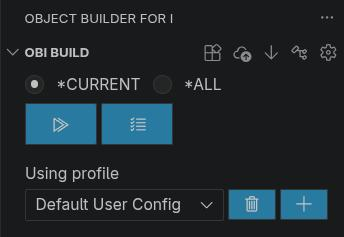
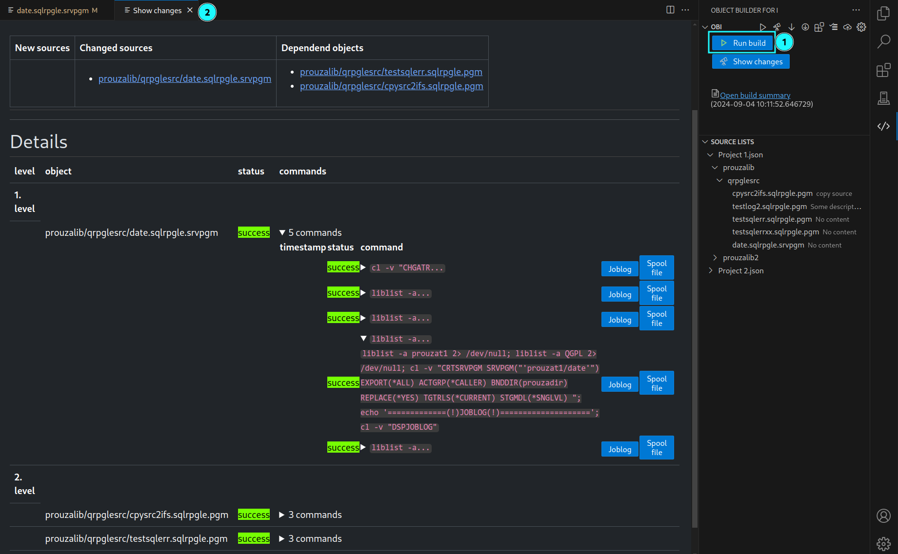

[← Back to README](../../README.md)

# Building

- [The OBI Build view](#the-obi-build-view)
- [Show changes](#show-changes)
- [Build summary](#build-summary)
- [Run build](#run-build)
- [Compile errors](#compile-errors)
- [Build history](#build-history)
- [Other actions](#other-actions)
- [Build output files](#build-output-files)


## The OBI Build view



| Element | Meaning |
|---|---|
| `*CURRENT` / `*ALL` | Build only the source in the active editor, or all changes in the project |
| ▷ | **Run build** |
| ☰ | **Show changes** |
| *Using profile* | Active user profile; 🗑 deletes it, ➕ copies it into a new profile (see [Profiles](configuration.md#profiles)) |

Toolbar buttons (left to right):

| Button | Action |
|---|---|
| Reset compiled object list | Mark all current sources as built (see [below](#reset-compiled-object-list)) |
| Transfer all to remote | Copy the project to the IFS (see [below](#transfer-all)) |
| Get last build results from IBM i | Download the results of the last build again |
| Dependency list | Open `.obi/etc/dependency.json` |
| Configuration | Open the configuration |

When a source (`.pgm`, `.srvpgm`, `.module`, `.file`) is open in the editor, the editor title bar also offers **Show single change**, **Run single build** and **Clear diagnostics** for that source.

### Status bar

The status bar shows the active profile and the result of the last build (a check mark with its time, or the number of failed sources), or the running operation, with the elapsed time in the tooltip. Click it for a menu: run build (all changes or the current source), show changes, open build summary, switch profile, cancel the running operation, show build output or log. Turn it off with the setting `obi.statusBar.enabled`.


## Show changes

**Show changes** creates the build list and opens the build summary. Nothing is executed on IBM i.

1. **Change detection**: OBI computes a hash of every source and compares it with the hashes of the last successful build (`.obi/etc/object-builds.json`).
   * Source not in the list → **new**
   * Different hash → **changed**
2. **Dependencies**: all objects depending on a new or changed source are added, recursively (see [Dependencies](dependencies.md)).
3. **Levels**: changed sources are placed on level 1, their dependent objects on higher levels. Within a level, files (`*.file`) come first.
   An object that appears several times is only built once, on its highest level.
4. **Commands**: for each source the build steps are resolved and all [variables](configuration.md#variables) are substituted.

The result is written to `.obi/build-output/compile-list.json`.

With `*CURRENT` (or **Show single change** in the editor), only the active source and its dependent objects are considered. The active source is always included, even if it has not changed.

> If a *local OBI path* is configured and contains a Python virtual environment, the local OBI backend generates the build list instead of the extension. This is optional.


## Build summary



**Header**
* Creation time, **open JSON file** (the compile list) and **open OBI log** (`.obi/log/main.log`)
* **Run build**: shown as long as not all commands succeeded
* **Add source**: add further sources (multi-select, searchable by name and description). Their dependent objects are added too.
  An added source that is already in the list gets new build commands. Dependent objects that were already built successfully are reset so they are built again (their commands and output are kept). With `ALWAYS_TRANSFER_RELATED_COPYBOOKS`, the copybooks they use are added on level 0. The levels of the whole list are calculated again, so a source can move to a higher level. This is the same with and without a local OBI.

**New sources / Changed sources / Dependent objects**: overview with links to the sources.

**Details**: remote user, host and IFS path, followed by all levels. For each source:
* **Checkbox**: exclude the source from the build
* **Source name**: opens the source and loads its [compile errors](#compile-errors)
* **Status**: `new`, `success`, `failed`, ...
* **Commands** (expandable), each with
  * a checkbox to exclude this single command
  * timestamp, status and the full command
  * ✏️ **Edit**: change the command for this build. The original command is kept in the compile list (`change-history`). A successful command is reset to `new` and dependent objects are reset as well.
  * **Joblog**, **Spool** and **Error**: open the output of the command in a read-only editor

> The checkboxes are only respected by the **Run build** button inside the build summary.
> **Run build** in the OBI Build view always creates a new build list first.

### Custom content

You can add your own HTML (and JavaScript) to the build summary, e.g. a form to record a ticket number with each build.
See [Custom build summary template](configuration.md#custom-build-summary-template).
The template is code from your project (Nunjucks templates can run JavaScript in VS Code): it is only used in a trusted workspace. Only use templates you trust.


## Run build

**Run build** in the OBI Build view first runs **Show changes**, then builds. **Run build** in the build summary builds the list as shown, including your changes.

In an editor, `Ctrl+Alt+Shift+B` builds the current source and `Ctrl+Alt+Shift+C` shows its changes (macOS: `Cmd` instead of `Ctrl`).

Steps:

1. **Confirm** the number of sources to build (setting `obi.build.confirmRun` turns the question off).
2. **Check the remote system**: home directory and `.bashrc` (offers to create them), project folder, configuration and OBI backend.
   If the project is missing on IBM i, **Transfer all** is offered.
3. **Upload** the configuration (project config, your active user profile, `constants.py`, `logger_config.py`), the sources to build and the build list (`compile-list.json` and the files directly in `.obi/tmp`, e.g. the lists of changed and dependent objects).
4. **Run** the OBI backend on IBM i in the remote project folder:
   ```sh
   <remote OBI path>/venv/bin/python -X utf8 <remote OBI path>/main.py -a run -p .
   ```
   Levels are built one after the other. With `max-parallel-builds` (see [General settings](configuration.md#general-settings)) the backend builds several sources of a level at the same time; their lines are then mixed in **OBI Build**. After a failed command no further source is started, sources that are already running are finished.
5. **Download** the results of this build. The build summary now shows the result of every command.
   * the files directly in `.obi/build-output` (compile list, status, object list, `compiled-object-list.md`) and in `.obi/tmp`
   * `.obi/log` (cleared before each run)
   * for each built source: its command outputs in `build-output-dir` (`<lib>/<member>/command-<n>.*`) and its compile messages in `evfevent-output-dir`

   Outputs of earlier builds that are still on the IBM i are not downloaded again. The OBI log lists the duration of each step (`Build timings: upload sources 0:02 · build list 0:01 · remote run 2:31 · download results 0:04 · total 2:38`).
6. **History**: a snapshot of the build (compile list with git branch/commit, and the configuration without `secret*` variables in `config.json`) is stored in `.obi/build-history` (see [Build history](#build-history)).
7. **Hashes**: only sources that were built **successfully** get their hash updated in `.obi/etc/object-builds.json`. Failed sources show up again on the next **Show changes**.

Only sources that still have commands that are not `success` are built. So after fixing an error you can simply **Run build** again in the build summary, and only the remaining commands run.

**Live output:** the output of the OBI backend appears in the output panel **OBI Build** while the build runs (also for *Show changes* with a local OBI). The progress notification shows the elapsed time and the latest line. Open it any time with **OBI: Show build output**. The setting `obi.build.revealOutput` decides when the panel opens by itself: `onError` (default), `onStart` or `never`.

**Cancel** (in the notification or in the OBI Build view) stops the build:
* before the build runs on IBM i, it stops after the current step (no further upload or build);
* while the build runs on IBM i, the OBI backend is stopped (`kill -TERM`). IBM i commands that are already running (e.g. a compile, or several with `max-parallel-builds`) finish first; the build summary shows the results up to the cancel.

If the OBI backend on IBM i is too old, the extension notifies you after the build.


## Compile errors

The default compile commands use `OPTION(*EVENTF)` and export the event file into the folder `evfevent-output-dir` (default `.obi/tmp/evfevent`), which is downloaded after the build.

After every build, the compiler messages of **all** built sources appear in the **Problems** view, each in the file it belongs to: messages in a copybook are shown in the copybook, at the right line and column
(severity < 10 → information, < 20 → warning, otherwise error). Messages of files outside the project (e.g. a QSYS member) are shown on line 1 of the source, with the member and line in the text.
A source that builds successfully loses its old messages. Opening a build from the history shows the messages of that build.

**Clear diagnostics** (editor title bar) removes them again.


## Build history

The **Build history** view lists all builds stored in `.obi/build-history`.

* **Date view** (default): date → time → sources
* **Source view**: source → date → time  
  Switch between both views with the button in the view title.
* **Filter** (🔍): select one or more sources to see only builds containing them. To remove the filter, confirm the selection with nothing selected.
* Click a **build** to open its build summary, including joblogs, spool files and compile errors of that build.
  **Run build** from a historical build summary builds that list again (all commands are reset to `new`).
* Click a **source** to open it.
* 🗑 on a **build** deletes that build, 🗑 on a **date** all builds of that date, and **Delete entire build history** in the view title all builds. Each asks first.

History entries are only stored locally. Add `.obi/build-history` to `.gitignore` (see [Configuration](configuration.md#files-in-the-obi-folder)).

### Build history size

The view title shows the number of builds and their size (e.g. `87 builds · 412 MB`).
After each build and when the workspace opens, older builds are deleted (folders whose name is no timestamp are never deleted):

* `obi.buildHistory.maxBuilds` (default `100`): keep the newest n builds, `0` = unlimited
* `obi.buildHistory.maxAgeDays` (default `0`): delete builds older than n days, `0` = unlimited

As long as neither setting is set, OBI asks once per workspace before it deletes existing builds (*Delete old builds* / *Keep all*). *Keep all* turns the automatic deletion off until you set one of the settings.


## Other actions

### Reset compiled object list

Stores the current hash of **every** source in `.obi/etc/object-builds.json`, which means "everything is built".
Use it after migrating existing sources, or when you know that IBM i is in sync with your local sources.

### Transfer all

Copies the project to the IFS folder configured as *remote ifs path*:

* **Only minimum**: `.obi/etc` and `.obi/build-output`
* **Yes**: the whole project folder (without `.git`, `.vscode`, `.gitignore`, `*.pyc`, ...)

> ⚠️ Both options **delete the remote project folder first**. A second dialog shows the folder and asks for confirmation.

### Get last build results from IBM i

Downloads the build output of the last build from IBM i again, updates the build history and the hashes, and refreshes the build summary.
Useful if the connection was lost during a build.


## Build output files

| File | Content |
|---|---|
| `.obi/build-output/compile-list.json` | The current build list: `timestamp`, `compiles` (levels → sources → commands with status, joblog, spool, errors), `git` (`branch`, `commit`), `custom_data` |
| `.obi/build-output/object-list.txt` | One line per object: `level\|library\|target library\|object\|type\|attribute\|source`. Useful for deployment scripts |
| `.obi/tmp/changed-object-list.json` | New and changed sources |
| `.obi/tmp/dependend-object-list.json` | Dependent objects |
| `.obi/tmp/evfevent/` | Compiler event files |
| `.obi/log/main.log` | Log of the OBI backend |
