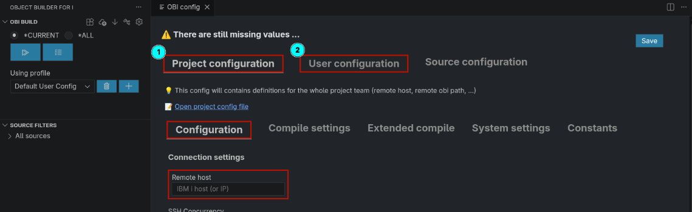
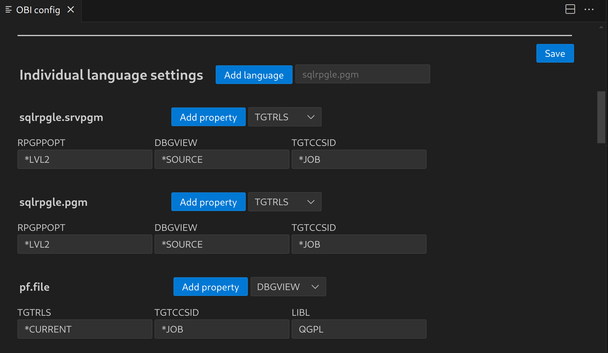

[← Back to README](../../README.md)

# Configuration

- [Opening the configuration](#opening-the-configuration)
- [Project and user configuration](#project-and-user-configuration)
- [Files in the .obi folder](#files-in-the-obi-folder)
- [Connection](#connection)
- [General settings](#general-settings)
- [Compile settings](#compile-settings)
- [Target library](#target-library)
- [Commands and steps](#commands-and-steps)
- [Variables](#variables)
- [Profiles](#profiles)
- [Per-source build settings](#per-source-build-settings)
- [Extended source processing](#extended-source-processing)
- [Custom build summary template](#custom-build-summary-template)
- [Language](#language)
- [VS Code settings and log](#vs-code-settings-and-log)
- [Updating the OBI backend](#updating-the-obi-backend)

The configuration is stored in the project folder under `.obi`. Only personal preferences are [VS Code settings](#vs-code-settings-and-log).


## Opening the configuration

⚙ **Configuration** in the toolbar of the OBI Build view.



The configuration has three areas, each with several tabs:

| Area | File |
|---|---|
| **Project configuration** | `.obi/etc/app-config.toml` |
| **User configuration** | `.obi/etc/.user-app-config.toml` (or the file of the active [profile](#profiles)) |
| **Source configuration** | `.obi/etc/source-config.toml` (see [Per-source build settings](#per-source-build-settings)) |

Tabs: **Configuration** (connection, paths, OBI backend), **Compile settings** (settings, variables, commands, steps), **Extended compile**, **System settings** (object types, encodings, threads) and **Constants** (file locations).

In a multi-root workspace, OBI works with the first folder that contains an OBI project (`.obi/etc/app-config.toml`). If there are several, it says so once; working with several projects at the same time is not supported yet.

You can also edit the TOML files directly (links *Open project config file* / *Open user config file*). Changes are picked up without reloading the window; an invalid configuration shows the *Invalid configuration* view until it is fixed.

> ℹ️ Saving from the configuration pages rewrites the whole TOML file: comments are lost and keys can change their order. Keep explanations in a README or this documentation rather than in comments, or edit the files directly if you want to keep their comments.


## Project and user configuration

* The **project configuration** holds everything the team shares. Commit it.
* The **user configuration** holds personal settings: SSH user, key, password, your own target library, ...
  It has the same structure, and every value set there **overrides** the project configuration.
  Empty values do not override.

In the user tab, each value of the project configuration has a button:

* Greyed-out fields use the **project value**. They are not saved in your user configuration, so later changes of the project configuration apply to you as well.
* <kbd>✎</kbd> (edit) **overrides** the value: the field becomes editable and gets a marker on the left. The value is saved in your user configuration, also `false` for a checkbox.
* <kbd>↺</kbd> (discard) uses the **project value again**: on *Save*, the value is removed from your user configuration. Clearing a field does the same.

> ℹ️ Older versions saved every checkbox of the user tab, so `ssh-agent`, *Always transfer related copybooks* and *Activate extended source processing* may be set to `false` in your user configuration. They are shown as overridden; click ↺ and save if you want the project value.

On each build, the project configuration and your active user configuration are uploaded to IBM i, so the OBI backend uses the same settings.


## Files in the .obi folder

| File / folder | Content | Git |
|---|---|---|
| `etc/app-config.toml` | Project configuration | ✅ commit |
| `etc/.user-app-config.toml`, `etc/.user-app-config-<profile>.toml` | User configuration per [profile](#profiles) | ❌ local |
| `etc/workspace-settings.json` | Active profile | ❌ local |
| `etc/source-config.toml` | [Per-source build settings](#per-source-build-settings) | ✅ commit |
| `etc/extended-source-processing-config.toml` | [Extended source processing](#extended-source-processing), project | ✅ commit |
| `etc/.user-extended-source-processing-config*.toml` | Extended source processing, user/profile | ❌ local |
| `etc/dependency.json` | [Dependencies](dependencies.md) | ✅ commit |
| `etc/source-infos.json` | [Source descriptions](sources.md#source-descriptions) | ✅ commit |
| `etc/deployment.toml` | URL and workflows of [i-Releaser](building.md#i-releaser-deployment) (the token is in VS Code's secret storage) | ✅ commit |
| `etc/object-builds.json` | Hashes of the last successful builds (change detection) | ❌ local, usually (it reflects what *you* built) |
| `etc/constants.py`, `etc/logger_config.py` | Settings for the OBI backend; do not modify | ✅ commit |
| `etc/source-list-local.json` | Generated source list | ❌ local |
| `source-list/*.json` | [Source filters](sources.md#source-filters) | ✅ commit |
| `.vscode/templates/` | [Custom build summary template](#custom-build-summary-template) | ✅ commit |
| `build-output/` | Current build list and results | ❌ local |
| `build-history/` | [Build history](building.md#build-history) | ❌ local |
| `tmp/`, `log/` | Temporary files, compiler events, logs | ❌ local |
| `cache/` | Cache of the source hashes | ❌ local |

*Initialize* creates a `.gitignore` with these entries (unless the folder already has one). In an existing git project without them, OBI offers once to append the missing entries; existing lines are never changed:

```gitignore
# OBI: personal configuration
.obi/etc/.user-app-config*.toml
.obi/etc/.user-extended-source-processing-config*.toml
.obi/etc/workspace-settings.json
.obi/etc/object-builds.json

# OBI: generated
.obi/log/
.obi/tmp/
.obi/cache/
.obi/build-output/
.obi/build-history/
.obi/etc/source-list-*.json
```

VS Code checks `dependency.json`, `source-infos.json`, the files in `source-list` and `compile-list.json` against a schema: you get completion and error marks while editing. This works at the default locations. If you moved a file with `dependency-list` or `source-infos`, add it to the VS Code setting `json.schemas`.


## Connection

Section `[connection]`.

| Key | Mandatory | Description |
|---|---|---|
| `remote-host` | ✅ | IBM i host name or IP |
| `ssh-user` | ✅ (user config) | IBM i user profile |
| `ssh-key` | | Path to your private SSH key; `~`, `$HOME` and `%USERPROFILE%` are expanded. A passphrase is asked for when connecting ([SSH setup](ssh.md#using-the-key-in-obi)) |
| `ssh-agent` | | `true`: use the running SSH agent (`SSH_AUTH_SOCK`, on Windows Pageant) |
| `ssh-port` | | SSH port (default 22) |
| `ssh-concurrency` | | Number of files transferred in parallel (1–32, default 5). More can be faster over slow connections; the SSH server may limit it |

**Password**: entered in the user configuration, but stored in VS Code's secret storage (per profile, host and user), never in a file.
Without key and stored password you are prompted when connecting. See [SSH setup](ssh.md).


## General settings

Section `[general]`. The defaults created by *Initialize* work for most projects.

| Key | Mandatory | Default | Description |
|---|---|---|---|
| `local-base-dir` | ✅ | `.` | Project folder on the PC (relative to the workspace) |
| `remote-base-dir` | ✅ | | Project folder in the IFS. Relative paths start at the home directory. `${workspaceFolderBasename}`, `$USER` and a leading `~` (the home directory, `$HOME` of the SSH user) are replaced. Must not be the home directory itself (`~`, `.`, `$HOME`) |
| `source-dir` | ✅ | `src` | Source directory below the project folder |
| `remote-obi-dir` | ✅ | | Path of the [OBI backend](https://github.com/andreas-prouza/obi) on IBM i |
| `local-obi-dir` | | | Optional path of a local OBI backend (with `venv`); used to generate the build list instead of the extension |
| `supported-object-types` | ✅ | `pgm, file, srvpgm, module, cpy, obj` | Last file extension of sources OBI handles |
| `file-system-encoding` | ✅ | `utf-8` | Used by the OBI backend |
| `console-output-encoding` | ✅ | `utf-8` | Used by the OBI backend |
| `max-threads` | ✅ | `20` | Parallel threads for hashing sources on your PC |
| `max-parallel-builds` | | `1` | Sources of one level the OBI backend builds at the same time on IBM i (OBI backend from November 2026). Levels are always built one after the other. Start low: sources of a level can still lock the same objects, e.g. service programs that add entries to the same binding directory. See [Parallel builds](https://github.com/andreas-prouza/obi/blob/main/docs/build-process.md#parallel-builds) |
| `evfevent-output-dir` | ✅ | `.obi/tmp/evfevent` | Where compile commands write compiler events |
| `cloud-ws-ssh-remote-host` | | | *Deprecated, ignored.* File links in remote workspaces (Remote-SSH, WSL, dev containers, codespaces) work without it |
| `compiled-object-list`, `source-list`, `source-infos`, `dependency-list`, `deployment-object-list`, `build-output-dir`, `compile-list`, `compiled-object-list-md` | ✅ | see [files](#files-in-the-obi-folder) | File locations (tab *Constants*) |

None of the base or OBI paths may be `/`.

Mandatory values that are missing are reported when the project opens, and the configuration is opened.


## Compile settings

Section `[global.settings.general]`: default parameters for all compile commands, available as [variables](#variables).

| Key | Mandatory | Example | Description |
|---|---|---|---|
| `TGTRLS` | ✅ | `*CURRENT` | |
| `DBGVIEW` | ✅ | `*ALL` | |
| `TGTCCSID` | ✅ | `*JOB` | |
| `STGMDL` | ✅ | `*SNGLVL` | |
| `LIBL` | ✅ | `["$(TARGET_LIB)", "QGPL"]` | Library list for the build. Each entry is added with the command `global.cmds.add-lible` → `$(SET_LIBL)` |
| `ACTGRP` | | `*CALLER` | |
| `INCLUDE_BNDDIR` | | | Binding directory |
| `INCDIR_RPGLE`, `INCDIR_SQLRPGLE` | | `'./src'` | Include directories |
| `RPGPPOPT` | | `*LVL2` | |
| `TARGET_LIB` | | | See [Target library](#target-library) |
| `TARGET_LIB_MAPPING` | | | See [Target library](#target-library) |
| `ALWAYS_TRANSFER_RELATED_COPYBOOKS` | | `false` | See [Copybooks](dependencies.md#copybooks) |

Parameters such as `ACTGRP(...)`, `BNDDIR(...)`, `TGTRLS(...)`, `STGMDL(...)`, `TGTCCSID(...)`, `DBGVIEW(...)` or `INCDIR(...)` are removed from a command if their value is empty.

**Language settings** override these values per source type (*Individual language settings*):

```toml
[global.settings.language."sqlrpgle.pgm"]
RPGPPOPT = "*LVL2"
DBGVIEW = "*SOURCE"
```




## Target library

`$(TARGET_LIB)` is determined for each source:

1. `TARGET_LIB = "MYLIB"` → that library; `TARGET_LIB = "*SOURCE"` or empty → the library folder of the source
2. then `TARGET_LIB_MAPPING` replaces that library, if it has an entry for it

`$(TARGET_LIB_ORIG)` is the library before the mapping. This is the same in the OBI backend.

Typical setup: no `TARGET_LIB` in the project configuration, and each developer sets their own test library in the user configuration.

```toml
[global.settings.general.TARGET_LIB_MAPPING]
prodlib = "devlib"
```


## Commands and steps

Build commands are shell commands executed in PASE (bash) in the remote project folder. IBM i commands are run with `cl -v "..."`.

| Section | Content |
|---|---|
| `[global.cmds]` | General, reusable commands, e.g. `add-lible`, `chg-src-ccsid`, `evfevent-export` |
| `[global.compile-cmds]` | Compile commands, e.g. `"rpgle.pgm"`, `srvpgm-crt` |
| `[global.steps]` | Which commands run for which source type, in order |

```toml
[global.steps]
"rpgle.pgm"    = [ "global.cmds.chg-src-ccsid", "global.compile-cmds.\"rpgle.pgm\"" ]
"rpgle.srvpgm" = [ "global.cmds.chg-src-ccsid", "global.compile-cmds.\"rpgle.mod\"",
                   "global.compile-cmds.bnddir-rmv", "global.compile-cmds.srvpgm-crt", "global.compile-cmds.bnddir-add" ]
```

* The step key is matched against the end of the source name (`order.rpgle.pgm` → `rpgle.pgm`); as fallback the last extension (`pgm`) is used.
* Steps under `"*ALL"` run first for every source.
* A step references a command by its path. Keys containing dots must be quoted: `global.compile-cmds."rpgle.pgm"`.
* Inside a command, `%global.cmds.xyz%` inserts another command.
* If `global.cmds.dspjoblog` is defined, it is appended to every step (with `$(joblog-separator)` replaced by `global.cmds.joblog-separator`).

The default configuration contains commands and steps for RPG, SQLRPGLE, CL, DDS (PF, DSPF, PRTF), SQL tables, views, indexes, procedures and functions, and service programs.


## Variables

Use `$(NAME)` in commands. Variables are resolved recursively.

**Built-in variables**

| Variable | Value (for `src/mylib/qrpglesrc/order.rpgle.pgm`) |
|---|---|
| `$(SOURCE)` | `mylib/qrpglesrc/order.rpgle.pgm` (relative to the source directory) |
| `$(SOURCE_FILE_NAME)` | `src/mylib/qrpglesrc/order.rpgle.pgm` (relative to the project folder) |
| `$(SOURCE_BASE_FILE_NAME)` | `order.rpgle.pgm` |
| `$(OBJ_NAME)` | `order` |
| `$(SRC_ATTR)` | `rpgle` |
| `$(SRC_TYPE)` | `pgm` |
| `$(TARGET_LIB)` | see [Target library](#target-library) |
| `$(TARGET_LIB_ORIG)` | the target library before `TARGET_LIB_MAPPING` |
| `$(SET_LIBL)` | commands to set the library list from `LIBL` |

Also available: all [compile settings](#compile-settings) (`$(TGTRLS)`, `$(ACTGRP)`, ...), all [general settings](#general-settings) (e.g. `$(evfevent-output-dir)`) and all commands of `[global.cmds]` (`$(global.cmds.evfevent-export)`).

If a name is set in several places, the later one wins, as in the OBI backend: compile settings → general settings → global variables → language settings → global commands → the `settings` of the source ([Per-source build settings](#per-source-build-settings)).

In SQL sources, write `$(SQL_TARGET_LIB)` where the target library belongs. The command `global.cmds.sql-set-target-lib` replaces it with the target library before running the SQL.

**Your own variables** (*Global variables* in the compile settings):

```toml
[global.variables]
MY_OPTION = "*YES"
```

Variables whose names start with `secret` are not substituted and are not written into the build list.
They are still uploaded to IBM i with the configuration (the user configuration with file mode `600`), so they are not a secure place for credentials. The build history stores the configuration of a build without them.

**Precedence** (lowest to highest): compile settings → per-source settings → language settings → general settings → global variables.


## Profiles

A profile is a separate user configuration, e.g. to build into a different library or with a different user.

* Files: `.obi/etc/.user-app-config.toml` (default profile) and `.obi/etc/.user-app-config-<name>.toml`
* Select the profile in **Using profile** in the OBI Build view.
* ➕ copies the current profile into a new one and activates it.
* 🗑 deletes the current profile and switches back to the default one.

Per profile: all user settings, the stored SSH password and the user's extended source processing rules.


## Per-source build settings

For single sources you can override settings, define own commands and replace the steps:

* **OBI: Individual build settings** on a source (Source filters tree, explorer or editor tab context menu)
* or the **Source configuration** area of the configuration

Stored in `.obi/etc/source-config.toml`, keyed by the source path relative to `src`:

```toml
["mylib/qrpglesrc/order.rpgle.pgm"]
settings = { ACTGRP = "ORDER", TARGET_LIB = "TESTLIB" }
source-cmds = { my-cmd = "cl -v \"CALL MYLIB/PREPARE\"" }
steps = [ "global.cmds.chg-src-ccsid", "source-cmds.my-cmd", "global.compile-cmds.\"rpgle.pgm\"" ]
```

* `settings` override the [compile settings](#compile-settings) for this source.
* `source-cmds` are commands only available for this source (`source-cmds.<id>`).
* `steps`, if not empty, **replace** all steps for this source (including `*ALL`).


## Extended source processing

The tab **Extended compile** (`extended-source-processing-config.toml` and the user variant) defines rules that select build steps and properties for groups of sources (e.g. by source name pattern) instead of single sources.
For now, prefer [steps per source type](#commands-and-steps) and [per-source build settings](#per-source-build-settings).

Each step of a rule has *either* a **Step** (e.g. `global.cmds.chg-src-ccsid`) *or* a **Command** (e.g. `cl -v "CALL $(TARGET_LIB)/AFTER"`); a command wins and runs once. *Add default steps* adds the steps of the source type after it, with the same properties: on by default for a step, off for a command. Details: [Extended source processing](https://github.com/andreas-prouza/obi/blob/main/docs/extended-source-processing.md) of the OBI backend.


## Custom build summary template

Add your own HTML to the [build summary](building.md#build-summary) by creating:

```
.obi/.vscode/templates/custom_build_list_template.html
```

It is included as a [Nunjucks](https://mozilla.github.io/nunjucks/) template and has access to, among others, `compile_list`, `app_config`, `compile_app_config` (configuration of the displayed build) and `is_compile_list_completed`.

To store data in the build list (and therefore in the build history), send it to the extension:

```html
<input id="ticket" placeholder="Ticket" value="{{ compile_list.custom_data.ticket or '' }}">
<button id="save_ticket">Save</button>
<script nonce="{{ global_stuff['nonce'] }}">
  document.getElementById('save_ticket').addEventListener('click', () => {
    window.vscode.postMessage({
      command: 'save_custom_data',
      type: 'ticket',
      data: document.getElementById('ticket').value
    });
  });
</script>
```

The data is stored as `custom_data.<type>` in `compile-list.json`.

The build summary has a Content-Security-Policy: scripts in the template only run with `nonce="{{ global_stuff['nonce'] }}"` (as above). Inline event handlers such as `onclick="…"` and scripts from other sites are blocked; use `addEventListener`. The page can't connect to any server either: to start an i-Releaser deployment, use the built-in [Start i-Releaser workflow](building.md#i-releaser-deployment).


## Language

The UI is available in English and German and follows VS Code's display language.


## VS Code settings and log

These settings are VS Code settings (*File → Preferences → Settings*, search for "OBI"), not part of the project configuration:

| Setting | Default | Description |
|---|---|---|
| `obi.build.revealOutput` | `onError` | When the output panel **OBI Build** opens by itself: `onStart`, `onError` or `never` |
| `obi.build.confirmRun` | `true` | Ask before a build runs |
| `obi.statusBar.enabled` | `true` | Show the OBI status bar item |
| `obi.log.writeFiles` | `true` | Write the log into `.obi/log` (`combined.log`, `error.log`) |
| `obi.log.maxFileSizeMB` | `5` | Maximum size of a log file; 3 files are kept per log (`combined.log`, `combined1.log`, …) |
| `obi.buildHistory.maxBuilds` | `100` | Builds kept in the [build history](building.md#build-history-size); `0` = unlimited |
| `obi.buildHistory.maxAgeDays` | `0` | Builds older than this many days are deleted from the build history; `0` = unlimited |
| `obi.backend.autoUpdateLocal` | `false` | [Update the local OBI backend](#updating-the-obi-backend) when VS Code starts |
| `obi.backend.autoUpdateRemote` | `false` | [Update the OBI backend on IBM i](#updating-the-obi-backend) once per VS Code session, before the first build |

The log is also shown in the output panel **OBI**. Its level is `info` by default; change it with **Developer: Set Log Level… → OBI** (e.g. `Debug` to see every remote command and its output). Values of `secret*` variables are replaced with `***` in the log.

## Updating the OBI backend

The OBI backend is a git checkout (see [Getting started](getting-started.md#1-prepare-your-ibm-i)). The extension can update it with `git pull`:

| Setting | When | Which backend |
|---|---|---|
| `obi.backend.autoUpdateLocal` | When VS Code starts | `local-obi-dir` |
| `obi.backend.autoUpdateRemote` | Once per VS Code session, before the backend runs on IBM i for the first time (usually the first build) | `remote-obi-dir` on the IBM i of the active profile |

* Only fast-forward updates: a checkout with own commits, or with local changes that conflict with the update, stays as it is, and the error is shown.
* A message says when the backend was updated. If its `requirements.txt` changed, run the setup script of the backend again (e.g. `./setup.sh` on IBM i, `setup.bat` on Windows), so the `venv` gets the new Python packages.
* If the update on IBM i fails (e.g. the IBM i has no internet access), the error is shown and the build goes on with the installed backend. Each IBM i is updated at most once per session, also if it failed.
* While the local backend is updated, OBI is busy (status bar); cancel it from the status bar menu or the **OBI Build** view.
* The backend on IBM i is often shared by the team: an update applies to everyone, and your user needs write access to its folder.

Without these settings, OBI shows **Update** after a run of an older backend. It updates the local backend (if `local-obi-dir` is set) and the one on IBM i.
