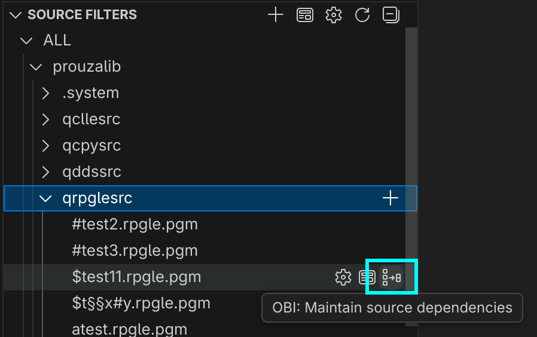
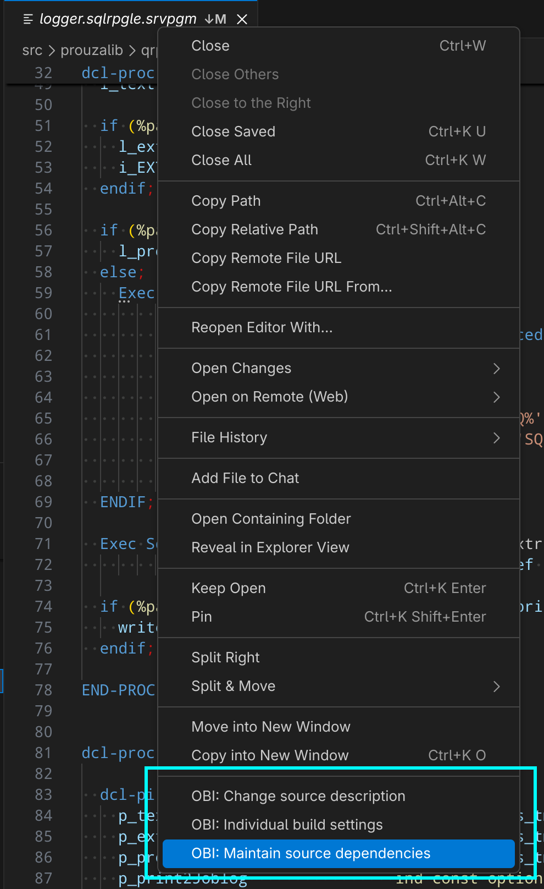
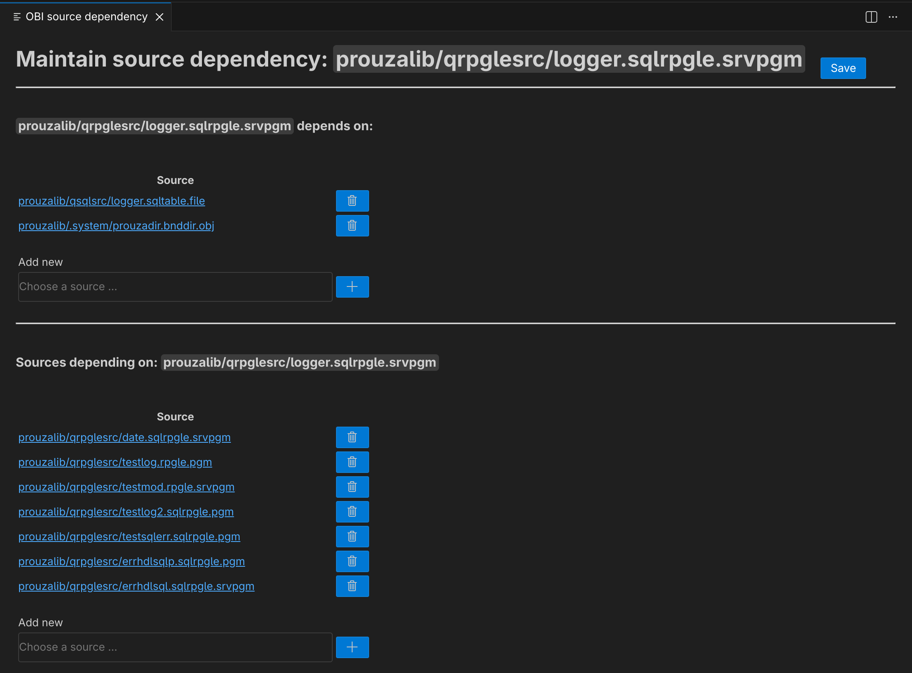

[← Back to README](../../README.md)

# Dependencies

- [Why dependencies](#why-dependencies)
- [Storage](#storage)
- [How dependencies affect the build](#how-dependencies-affect-the-build)
- [Maintaining dependencies](#maintaining-dependencies)
- [Copybooks](#copybooks)


## Why dependencies

Without dependencies, OBI only builds the sources you changed.
With dependencies, OBI also rebuilds every object that uses a changed source, and it does so in the correct order.

Example: when a table changes, all programs using that table are recompiled after the table has been created.


## Storage

Dependencies are stored in `.obi/etc/dependency.json` (setting *dependency-list*). Commit this file to git.

Each key is a source; its value lists the sources it **depends on**.
All names are paths relative to the source directory (`src`):

```json
{
  "mylib/qrpglesrc/order.sqlrpgle.pgm": [
    "mylib/qddssrc/orderscr.dspf.file",
    "mylib/qsqlsrc/orders.sqltable.file",
    "mylib/qrpglesrc/utils.rpgle.srvpgm"
  ],
  "mylib/qrpglesrc/utils.rpgle.srvpgm": [
    "mylib/qrpglesrc/utils_h.rpgle.cpy"
  ]
}
```

Read: *order.sqlrpgle.pgm depends on orderscr.dspf.file, orders.sqltable.file and utils.rpgle.srvpgm.*


## How dependencies affect the build

With the example above:

| Changed source | Built (level) |
|---|---|
| `orders.sqltable.file` | 1: `orders.sqltable.file` → 2: `order.sqlrpgle.pgm` |
| `utils_h.rpgle.cpy` | 1: `utils_h.rpgle.cpy` → 2: `utils.rpgle.srvpgm` → 3: `order.sqlrpgle.pgm` |
| `order.sqlrpgle.pgm` | 1: `order.sqlrpgle.pgm` only |

* Dependencies are resolved **recursively**.
* An object that is reached several ways is built only once, on its highest level.
* Within a level, files (`*.file`) are built first.
* Dependent sources that do not exist locally are skipped.
* Circular dependencies are detected and reported as an error.


## Maintaining dependencies

Open the dependency editor for a source:

* In the **Source filters** tree, via the icon on a member

  

* Via the context menu of the explorer or the editor tab: **OBI: Maintain source dependencies**

  

The editor shows both directions. Add or remove entries, then click **Save**:

* **\<source\> depends on**: sources this source needs
* **Sources depending on \<source\>**: sources that need this source



To see or edit the whole list as JSON, use **Dependency list** in the toolbar of the OBI Build view.

When you rename a source, its dependency entries are updated automatically (see [Sources](sources.md#create-rename-and-delete-sources)).


## Copybooks

Copybooks (`*.cpy`) are not compiled, but they must exist in the IFS for the programs that include them.
They are transferred when they appear in the build list, e.g. because they changed.

If you set `ALWAYS_TRANSFER_RELATED_COPYBOOKS = true` in the [compile settings](configuration.md#compile-settings),
OBI adds all copybooks the built objects depend on as level `0` to every build. This keeps the copybooks in the IFS in sync even when only a program changed.
A copybook is only transferred if [build steps](configuration.md#commands-and-steps) are defined for its type. The default configuration has steps for `rpgle.cpy` and `sqlrpgle.cpy`.
