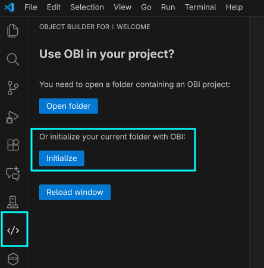
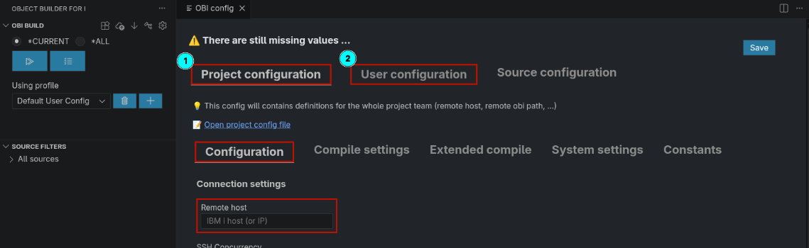
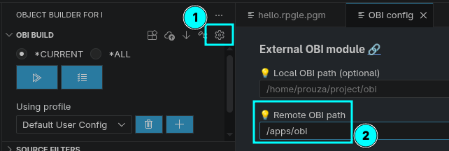
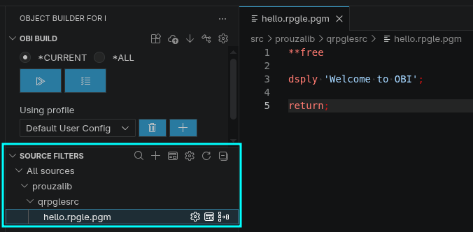
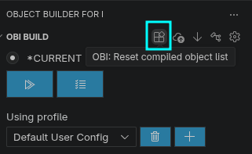

[← Back to README](../../README.md)

# Getting started

VS Code also has a short walkthrough: *Help → Get Started → Get started with OBI*.

- [1. Prepare your IBM i](#1-prepare-your-ibm-i)
- [2. Initialize the project](#2-initialize-the-project)
- [3. Minimum configuration](#3-minimum-configuration)
- [4. Source layout](#4-source-layout)
- [5. First build](#5-first-build)
- [Migrating existing sources to OBI](#migrating-existing-sources-to-obi)


## 1. Prepare your IBM i

1. **SSH, bash and home directory**  
   Follow the [SSH setup](ssh.md). OBI runs every remote command with `bash`, and it needs the home directory of the user (`HOMEDIR` of the user profile, usually `/home/<user>`) with a `.bashrc` that puts `/QOpenSys/pkgs/bin` on the `PATH`.
   If the home directory or `.bashrc` is missing, the extension offers to create it before the first build.

2. **Python 3.12 or higher** (via YUM).

3. **Install the OBI backend** somewhere in the IFS:

   ```sh
   git clone https://github.com/andreas-prouza/obi /path/to/obi
   cd /path/to/obi
   ./setup.sh
   ```

   `setup.sh` creates a Python virtual environment (`venv`) and installs the required modules.
   Before each build the extension checks that `<obi path>/venv/bin/python` exists.
   See the [OBI repository](https://github.com/andreas-prouza/obi) for details.
   The extension can keep it up to date with `git pull`: see [Updating the OBI backend](configuration.md#updating-the-obi-backend).


## 2. Initialize the project

OBI needs a **trusted** workspace (it runs the build commands and programs configured in the project); in Restricted Mode it stays disabled.

1. On your PC, create an empty project folder (or clone your project's git repository).
2. Open the folder in VS Code.
3. Switch to the **Object Builder for i** view in the activity bar.
   You will see the welcome screen:

   

4. Click **Initialize**.  
   This creates the `.obi` folder with the default configuration, a source filter *All sources* and a sample source `src/prouzalib/qrpglesrc/hello.rpgle.pgm`.
   Existing files are never overwritten.

5. The OBI views appear and the configuration opens (see next step).


## 3. Minimum configuration

The configuration has two areas:

* **Project configuration** (`.obi/etc/app-config.toml`)  
  Settings shared with all team members: remote host, paths, compile settings, commands. Commit it to git.
* **User configuration** (`.obi/etc/.user-app-config.toml`)  
  Your personal settings. Every value set here **overrides** the project configuration (e.g. your own target library). Keep it out of git.



As long as mandatory values are missing, the configuration shows *"There are still missing values ..."*.
Fill in at least:

| Where | Setting | Example |
|---|---|---|
| Project | **Remote host** | `my-ibmi.example.com` |
| Project | **Remote OBI path**: where you installed the OBI backend | `/path/to/obi` |
| Project | **Remote ifs path**: project folder in the IFS used for compiling | `${workspaceFolderBasename}` (relative to your home directory) |
| Project | **Compile settings**: `TGTRLS`, `DBGVIEW`, `TGTCCSID`, `STGMDL`, `LIBL` | defaults are provided |
| User | **User**: your IBM i user profile | `myuser` |
| User | **SSH Key** *or* **Password** | `/home/me/.ssh/ibmi_rsa` |



Notes:
* Use an absolute path for the SSH key; `~` and environment variables are not expanded for local paths.
* The password is **not** written into any file. It is stored in VS Code's secret storage (per profile, host and user). Without a key and a stored password, you are prompted on each connection.
* None of the base or OBI paths may be `/`.

Click **Save**. Once the configuration is complete, OBI is ready (no reload needed):



All settings are described in [Configuration](configuration.md).


## 4. Source layout

Sources are stream files below the source directory (default `src`), mirroring library, source file and member:

```
src/<library>/<source file>/<member>.<attribute>.<type>
```

Examples:

```
src/mylib/qrpglesrc/order.sqlrpgle.pgm
src/mylib/qrpglesrc/utils.rpgle.srvpgm
src/mylib/qrpglesrc/utils_h.rpgle.cpy
src/mylib/qddssrc/customer.pf.file
src/mylib/qsqlsrc/orders.sqltable.file
```

* The **attribute** (`rpgle`, `sqlrpgle`, `clle`, `pf`, `dspf`, `sqltable`, ...) together with the **type** selects the build steps (e.g. `rpgle.pgm`).
* The **type** must be one of the *supported object types*: `pgm`, `file`, `srvpgm`, `module`, `cpy`, `obj`.
* By default the **library folder** is used as target library (see [target library](configuration.md#target-library)).

See [Sources](sources.md) for working with sources in the extension.


## 5. First build

1. Open the **OBI Build** view.
2. Select `*ALL` and click **Show changes**. The build summary lists all new and changed sources.
3. Click **Run build** and confirm.

On the first build, OBI detects that the project is missing on IBM i and offers **Transfer all** (also available in the Command Palette as **OBI: Transfer all to remote**):

* **Only minimum**: transfers only `.obi/etc` and `.obi/build-output`. Sources are transferred with each build anyway.
* **Transfer all**: transfers the whole project folder (without `.git`, `.vscode` and similar).

> ⚠️ **Both options delete the remote project folder first.**
> You get a second confirmation showing the absolute folder on the IBM i. OBI refuses to delete system folders, your home directory (or a folder containing it) and folders directly below `/`, and asks again if the folder doesn't contain an OBI project (`.obi/etc/app-config.toml`).

More about building in [Building](building.md).


# Migrating existing sources to OBI

1. **Git** (recommended when working in a team)
   1. Create a git repository (GitHub, GitLab, Gitea, on your IBM i, ...).
   2. Clone it on your PC and [initialize](#2-initialize-the-project) OBI in it.

2. **Get your sources out of QSYS**  
   Copy your source members into IFS stream files with the layout described in [Source layout](#4-source-layout).
   You can use the RPG program [cpysrc2ifs](https://github.com/andreas-prouza/ibm-i-build-obi/blob/main/src/prouzalib/qrpglesrc/cpysrc2ifs.sqlrpgle.pgm) for that.
   Then copy the result into the `src` folder of your local project (e.g. via git, `scp` or a network share).

3. **Reset the compiled object list**  
   Without this, OBI treats every source as *new* and would build all of them.
   **Reset compiled object list** (toolbar of the OBI Build view) stores the current hash of every source as "already built".
   From then on, **Show changes** only shows sources you really changed.

   

4. **Define dependencies**  
   With a dependency list OBI rebuilds dependent objects in the correct order (e.g. service programs, files).
   This can be done step by step. See [Dependencies](dependencies.md).

5. **Commit** everything (sources and shared `.obi` configuration) to your git repository. Personal and generated files are kept out by the `.gitignore` that *Initialize* created (see [Files in the .obi folder](configuration.md#files-in-the-obi-folder)).
   See [which files to commit](configuration.md#files-in-the-obi-folder).
