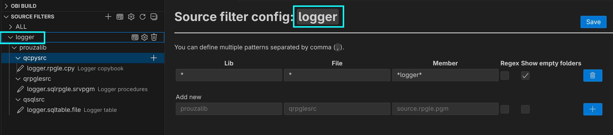
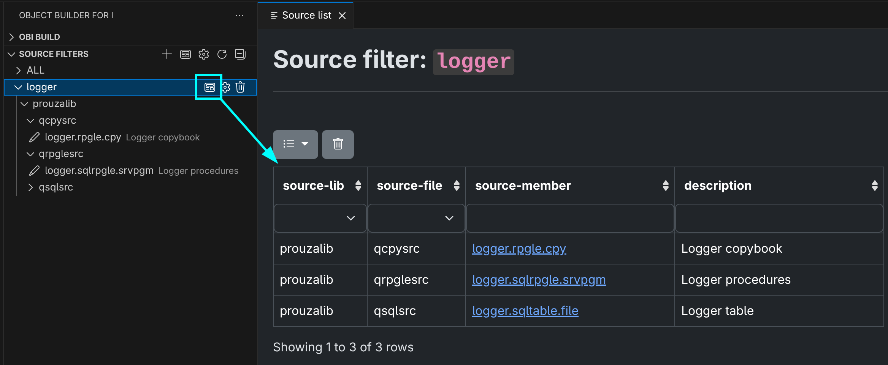
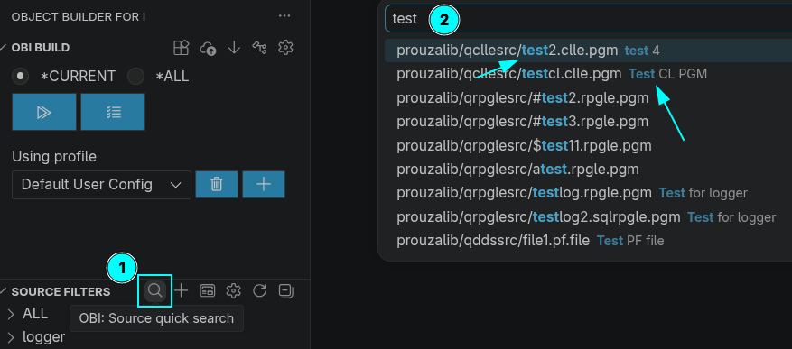
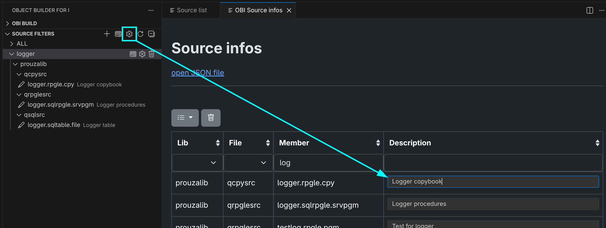

[← Back to README](../../README.md)

# Sources

- [Folder layout](#folder-layout)
- [Source filters](#source-filters)
- [Table view](#table-view)
- [Quick search](#quick-search)
- [Source descriptions](#source-descriptions)
- [Create, rename and delete sources](#create-rename-and-delete-sources)
- [Source actions](#source-actions)


## Folder layout

All sources are stream files below the source directory (setting *source-dir*, default `src`):

```
src/<library>/<source file>/<member>.<attribute>.<type>
```

e.g. `src/mylib/qrpglesrc/order.sqlrpgle.pgm`.

Everywhere in OBI (dependencies, source settings, descriptions, build lists) a source is identified by its path **relative to the source directory**, e.g. `mylib/qrpglesrc/order.sqlrpgle.pgm`.

The type (last extension) must be one of the *supported object types* (default `pgm`, `file`, `srvpgm`, `module`, `cpy`, `obj`).
The project initialization adds file associations (`.vscode/settings.json`) so VS Code recognizes these files, e.g. `*.rpgle.pgm` as RPGLE.


## Source filters

The **Source filters** view shows your sources as a tree: *filter → library → source file → member*, including descriptions.
Each filter is a JSON file in `.obi/source-list/` and can be shared with your team via git.



* ➕ in the view title creates a new filter. It opens the filter configuration.
* On a filter: show as [table](#table-view), ⚙ edit the filter configuration, 🗑 delete the filter (without confirmation).
* ↻ refreshes the view. New and deleted source files are picked up automatically.
* When you switch the editor, the active source is revealed in the tree.
* Members whose file does not exist are marked with an error icon.

### Filter configuration

A filter consists of one or more rows. A source is shown if it matches **any** row.

| Column | Meaning |
|---|---|
| Lib / File / Member | Pattern for library, source file and member (case-insensitive). Several patterns can be separated by comma; they are split into separate rows |
| Regex | Off: wildcard pattern (`*`, `?`). On: regular expression that must match the whole name (e.g. `.*`) |
| Empty folder | Also show libraries and source files without members |

Example `.obi/source-list/Orders.json`:

```json
[
  {
    "source-lib": "mylib",
    "source-file": "qrpglesrc",
    "source-member": "ord*",
    "use-regex": false,
    "show-empty-folders": false
  }
]
```


## Table view

Opens a filter as a table which can be sorted and filtered by library, file, member and description.
Click a member to open the source.




## Quick search

🔍 in the title of the Source filters view (command **OBI: Source quick search**) searches all sources by name **and description** and opens the selected one.




## Source descriptions

Descriptions are stored in `.obi/etc/source-infos.json` and shown in the tree, the table view and the quick search.

* **Change source description**: on a member in the tree, or via the context menu of the explorer or editor tab
* **Show source infos** (view title): read-only table of all descriptions
* **Maintain source infos** (view title): edit all descriptions in a table




## Create, rename and delete sources

In the Source filters tree:

* On a **library**: **Add source file** creates a new source file folder.
* On a **source file**: **Add source member** creates an empty source and opens it. The name must end with a supported type, e.g. `new.rpgle.pgm`.
* On a **member** (context menu):
  * **Rename**: renames the file
  * **Delete**: deletes the file **immediately, without confirmation**. Entries in the dependency list, source settings and descriptions are not removed.

**Renames keep the configuration in sync.** When you rename a source file in the Source filters tree or in the VS Code Explorer, OBI updates the source name in:

* the per-source build settings (`source-config.toml`)
* the dependency list (`dependency.json`)
* the compiled object list (`object-builds.json`)
* the descriptions (`source-infos.json`)

This works for renaming single source files. Renaming a library or source file folder does **not** update the configuration.


## Source actions

On a member in the tree, and in the context menu of the explorer and editor tab:

| Action | Description |
|---|---|
| **OBI: Individual build settings** | Settings and build steps for this source only. See [Per-source build settings](configuration.md#per-source-build-settings) |
| **OBI: Maintain source dependencies** | Which sources this source depends on, and which depend on it. See [Dependencies](dependencies.md) |
| **OBI: Change source description** | See [Source descriptions](#source-descriptions) |
